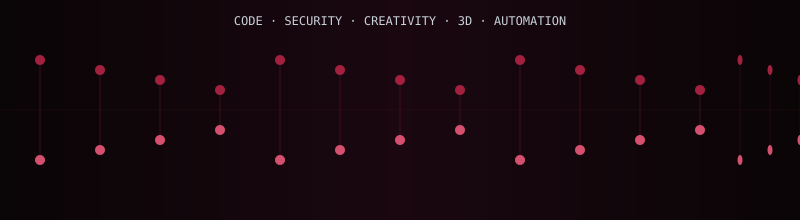
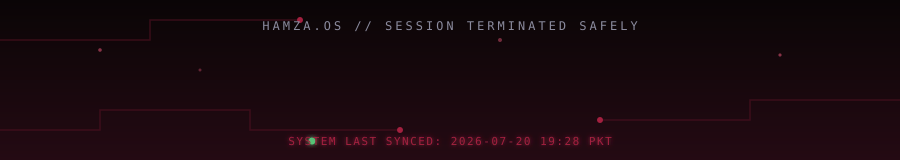

# Hamza Aamir

### Full-Stack Software Engineer in Karachi, Pakistan | React · Node.js · Express.js · Laravel · Three.js

Hi, I'm **Hamza Aamir**, a full-stack software engineer and web developer from Karachi, Pakistan. I build full-stack web applications with the MERN stack (MongoDB, Express.js, React, Node.js) and Laravel, and I create interactive 3D experiences for the browser with Three.js and React Three Fiber. I'm also learning cybersecurity fundamentals so I can build safer applications.

🌐 **Portfolio:** [hamzaamir-portfolio.web.app](https://hamzaamir-portfolio.web.app)
📧 **Email:** [hamzaamir72007@gmail.com](mailto:hamzaamir72007@gmail.com)

---

## ⬡ About Me

I enjoy building products end to end: React interfaces, Node.js and Express APIs, MongoDB and MySQL databases, and Laravel back ends. I completed the MERN stack and I'm now going deeper into Next.js, TypeScript and real-time 3D on the web.

- **Full-stack web development** with React, Node.js, Express.js, MongoDB, Laravel and MySQL
- **Interactive 3D web experiences** with Three.js, React Three Fiber, Drei and Rapier physics
- **Creative technology**: animation, motion and playful interaction in the browser
- **Cybersecurity fundamentals**: learning how web apps are attacked so I can defend them better

Open to freelance projects, collaborations and software engineering roles.

<!-- 

 -->

---

## ⬡ Technical Skills

| Area | Technologies |
|---|---|
| **Languages** | HTML5, CSS3, JavaScript, TypeScript, PHP, C#, Dart, SQL |
| **Frontend** | React.js, Next.js *(learning)*, Tailwind CSS, Bootstrap, jQuery, AJAX, Zustand, TanStack Query, React Hook Form, Zod |
| **Backend** | Node.js, Express.js, Laravel, REST APIs, MongoDB, MySQL, Firebase |
| **3D & creative** | Three.js, React Three Fiber, Drei, Rapier physics, Blender *(learning)*, Framer Motion, GSAP *(exploring)* |
| **Tools & other** | Git, GitHub, GitHub Actions, CI/CD fundamentals, Vite, .NET 8, WinUI 3, Flutter |

<b>⬡ Tech stack icons</b>

 

---

## ⬡ Featured Projects

### Forge: Fitness Tracker
An interactive, dark-themed fitness tracking app with 3D gym visuals, built with **React, TypeScript and Vite**. It is my testing ground for Three.js, React Three Fiber and Rapier physics.
[Repository](https://github.com/x-hamza47/fitness-tracker)

### MarketLink: eGreen Basket
A full-stack marketplace built for the Aptech Techwiz competition with **React, Express.js and MongoDB**. It has separate workflows for farmers, administrators and customers, and a pay-at-pickup ordering model.
Repository: *add link here*

### Interactive 3D Portfolio
My portfolio, built with **React, Three.js and React Three Fiber**, with 3D character animation and interactive physics experiments.
[Live site](https://hamzaamir-portfolio.web.app) · Repository: *add link here*

### Laravel Projects
- **Vaccination Management System**: Laravel, MySQL and Tailwind CSS platform for vaccination records, appointments and administration. [Repository](https://github.com/x-hamza47/vaccine-management-laravel)
- **Tic Tac Toe**: responsive browser game in HTML, CSS and JavaScript. [Repository](https://github.com/x-hamza47/tic-tac-toe) · [Live demo](https://tic-tac-toe-three-mu-94.vercel.app)

---

## ⬡ Currently Learning

- **Next.js**: building a new portfolio to deploy on Vercel
- **Advanced 3D web development**: React Three Fiber, Drei and shaders
- **Browser physics**: Rapier
- **CI/CD**: automated builds, tests and deployments with GitHub Actions
- **Blender**: modelling and preparing assets for the web

---

## ⬡ GitHub Stats

---

## ⬡ Contact

 

 

