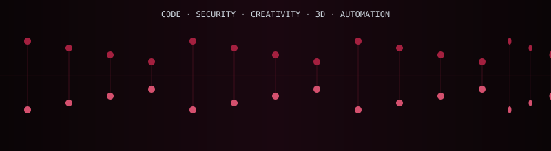

# Hamza Aamir

### Full Stack Software Engineer and Cybersecurity Researcher
**React, Angular, Node.js, Laravel, ASP.NET, AI chatbots, Three.js and ethical hacking**

Hi, I'm **Hamza Aamir**, a full stack developer from Karachi with 4+ years of hands-on experience. I build web apps and APIs with React, Angular, Node.js, Laravel and ASP.NET, work with every major database (SQL Server, PostgreSQL, MySQL, SQLite and MongoDB), add AI chatbots and workflow automation to real products, ship Windows software in C# and .NET 8, and make interactive 3D scenes for the browser with Three.js. I am also an ethical hacker and cybersecurity researcher, so I know how apps get broken and how to build them so they don't.

I work remotely with clients in any time zone, and I care most about clean code, clear communication and software that simply works.

<table align="center">
<tr>
<td align="center" width="33%"><h3>4+</h3>years of experience</td>
<td align="center" width="33%"><h3>End to end</h3>from planning to deployment and SEO</td>
</tr>
</table>

**Portfolio:** [hamzaamir-portfolio.web.app](https://hamzaamir-portfolio.web.app)
**Fiverr:** [fiverr.com/hamzaamirdev](https://www.fiverr.com/hamzaamirdev)
**LinkedIn:** [linkedin.com/in/hamza-aamir-dev](https://www.linkedin.com/in/hamza-aamir-dev/)
**Email:** [hamzaamir72007@gmail.com](mailto:hamzaamir72007@gmail.com)

---

## ⬡ About Me

I like building products from start to finish: the React interface, the Node.js or Laravel back end, the database, and the AI or SEO work that makes the product stand out. I have delivered CMS platforms, review directories, a farmers market marketplace, an e-commerce store, admin dashboards and a salon POS desktop app.

Right now I am going deeper into advanced 3D on the web and Blender. I am open to freelance projects, collaborations and software engineering roles.

---

## ⬡ What I Can Build For You

<table>
<tr>
<td valign="top" width="33%">
<b>Custom web applications</b> 
Full stack apps with React, Node.js, Express and MongoDB, or Laravel and MySQL, from first plan to deployment.
</td>
<td valign="top" width="33%">
<b>AI chatbots and integrations</b> 
Chat assistants for websites and apps, connected to AI APIs, plus workflow automation that links your tools together.
</td>
<td valign="top" width="33%">
<b>CMS and directory platforms</b> 
Laravel content systems, admin dashboards, blogs and review sites that are easy for a team to manage.
</td>
</tr>
<tr>
<td valign="top" width="33%">
<b>Technical SEO</b> 
Dynamic metadata, Schema.org markup, XML sitemaps, clean URLs and image optimization.
</td>
<td valign="top" width="33%">
<b>REST APIs and databases</b> 
Authentication, validation and a clean data layer on SQL Server, PostgreSQL, MySQL or MongoDB, containerized with Docker when needed.
</td>
<td valign="top" width="33%">
<b>ASP.NET, .NET and desktop software</b> 
C# back ends and offline-first Windows apps with SQL Server or SQLite, receipts and reporting.
</td>
</tr>
</table>

Want to talk about your idea? [Message me on Fiverr](https://www.fiverr.com/hamzaamirdev) or [send an email](mailto:hamzaamir72007@gmail.com).

---

## ⬡ Technical Skills

| Area | Technologies |
|---|---|
| **Languages** | HTML5, CSS3, JavaScript, TypeScript, C#, PHP, Dart, SQL |
| **Frontend** | React.js, Angular, Next.js, HTML5, CSS3, Tailwind CSS, Bootstrap, jQuery, AJAX, Zustand, TanStack Query, React Hook Form, Zod |
| **Backend** | C#, ASP.NET, .NET, Node.js, Express.js, Laravel, PHP, REST APIs, Firebase |
| **Databases** | Microsoft SQL Server, PostgreSQL, MySQL, SQLite, MongoDB, Mongoose, EF Core |
| **AI and automation** | AI chatbots, AI API integration, prompt design, conversational interfaces, workflow automation |
| **SEO** | Technical SEO, Schema.org, dynamic metadata, XML sitemaps, robots.txt |
| **Desktop** | C#, .NET 8, WinUI 3, MVVM |
| **3D and creative** | Three.js, React Three Fiber, Drei, Rapier physics, Framer Motion, Blender (learning), GSAP (exploring) |
| **Security** | Penetration testing, Burp Suite, Wireshark, phishing simulations, mobile device security testing, web app vulnerability assessment |
| **DevOps and tools** | Git, GitHub, GitHub Actions, CI/CD, Docker, Vite, Postman, Figma, Flutter, Hostinger, Vercel |

<b>⬡ Tech stack icons</b>

 

---

## ⬡ Cybersecurity and Ethical Hacking

I am also an ethical hacker and cybersecurity researcher. I test web apps, networks and devices with permission, find the weak spots before attackers do, and bring that mindset into every app I build.

<table>
<tr>
<td valign="top" width="25%"><b>Web app testing</b> Intercepting and testing requests and finding vulnerabilities with Burp Suite.</td>
<td valign="top" width="25%"><b>Network analysis</b> Inspecting traffic and protocols with Wireshark.</td>
<td valign="top" width="25%"><b>Phishing simulations</b> Awareness exercises that show how social engineering works.</td>
<td valign="top" width="25%"><b>Mobile device security</b> Testing how phones can be remotely controlled and how to defend them.</td>
</tr>
</table>

---

## ⬡ Featured Projects

<table>
<tr>
<td valign="top" width="50%">
<b>Forge Fitness Tracker</b> 
A free fitness app to plan workouts, log sets and reps, and track nutrition and progress. Built with React, TypeScript, Node.js, Express and MongoDB.  
<a href="https://forge-fitness-tracker-sigma.vercel.app/">Live site</a> | <a href="https://github.com/x-hamza47/fitness-tracker">Source code</a>
</td>
<td valign="top" width="50%">
<b>MarketLink Farmers Market Platform</b> 
Connects local farmers with customers. Browse markets on a map, pre-order produce and pick it up in person, with farmer and admin dashboards and an integrated AI chatbot. Built with React, Tailwind CSS, Zustand, TanStack Query, Express and MongoDB.  
<a href="https://marketlink-eta.vercel.app/">Live site</a> | <a href="https://github.com/x-hamza47/marketlink">Source code</a>
</td>
</tr>
<tr>
<td valign="top" width="50%">
<b>Blue Orbit CMS Platform</b> 
A config-driven Laravel CMS with reusable page components, a full blog system, drag and drop section ordering and an Editor.js editor, built with complete technical SEO.  
<a href="https://blueorbitdigitalagency.com/">Live site</a>
</td>
<td valign="top" width="50%">
<b>Top Firms Reviewer</b> 
A directory where service companies register, build a profile and get reviewed, with a built-in blog. Built with Laravel, MySQL and Schema.org, with a fully optimized technical SEO setup.  
<a href="https://topfirmsreviewer.com/">Live site</a>
</td>
</tr>
<tr>
<td valign="top" width="50%">
<b>Salon POS Desktop App</b> 
An offline-first Windows point of sale app with services, orders, checkout, receipt printing and a sales dashboard. Built with C#, .NET 8, WinUI 3, EF Core and SQLite. Client project, source code is private.
</td>
<td valign="top" width="50%">
<b>AI chatbot and integration work</b> 
Chat assistants and AI-powered features built into web apps, like the chatbot inside MarketLink. Ask me for more examples through my <a href="https://hamzaamir-portfolio.web.app/projects">portfolio</a> or <a href="https://www.fiverr.com/hamzaamirdev">Fiverr</a>.
</td>
</tr>
</table>

**More on GitHub:**
[Vaccination Management System](https://github.com/x-hamza47/vaccine-management-laravel) (Laravel, MySQL, Tailwind CSS),
[Tic Tac Toe with Minimax AI](https://github.com/x-hamza47/tic-tac-toe) ([live demo](https://tic-tac-toe-three-mu-94.vercel.app)),
[Lexio](https://github.com/x-hamza47/lexio) and
[JS Algorithms](https://github.com/x-hamza47/js-algorithms).

See everything on my [portfolio projects page](https://hamzaamir-portfolio.web.app/projects).

---

## ⬡ Experience

<table>
<tr>
<td valign="top" width="33%">
<b>Freelance Software Developer</b> 
Self-employed, May 2026 to Jul 2026  
Built an offline-first Windows POS app for a salon with authentication, order processing, receipt printing and a sales dashboard.
</td>
<td valign="top" width="33%">
<b>Full Stack Developer</b> 
Blue Orbit Digital Agency, Mar 2026 to Jun 2026  
Built reusable CMS components, a blog system and a config-driven section engine in Laravel, and handled the technical SEO.
</td>
<td valign="top" width="33%">
<b>Remote Website Developer</b> 
Top Firms Reviewer, Nov 2025 to Mar 2026  
Built a Laravel directory and review platform with company dashboards, full technical SEO and Hostinger deployment.
</td>
</tr>
</table>

---

## ⬡ Currently Learning

<table>
<tr>
<td valign="top" width="50%"><b>Advanced 3D on the web</b> React Three Fiber, Drei and custom shaders</td>
<td valign="top" width="50%"><b>Blender</b> Modelling and preparing 3D assets for the web</td>
</tr>
</table>

---

## ⬡ GitHub Stats

---

## ⬡ Let's Connect

Have a project in mind or a role to fill? I'd love to hear about it.

 

 

